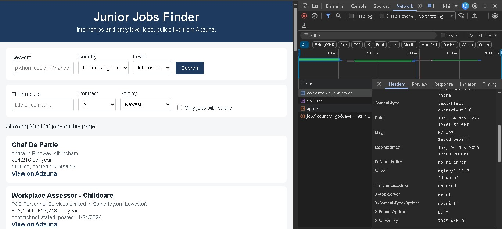
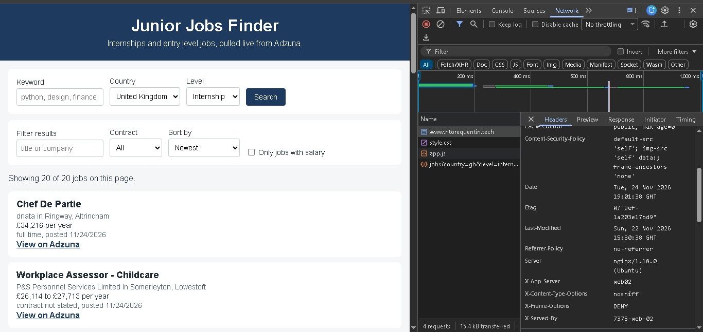

# Junior Jobs Finder

A web application that helps students and early-career job seekers find **internships, graduate roles, junior positions and entry-level jobs** in several countries. It pulls live listings from the Adzuna job search API and lets users search, filter, sort and page through the results.

The application runs on two web servers (Web01 and Web02) behind an HAProxy load balancer (Lb01) with HTTPS.

| | |
|---|---|
| **Live site** | https://www.ntorequentin.tech |
| **Demo video (max 2 min)** | [https://www.youtube.com/watch?v=n5MhPrcnyks] |
| **Repository** | https://github.com/Quentin712/junior-jobs-finder |
| **Login required?** | No. The app has no user accounts, so there are no login credentials. |
| **API keys** | Provided in the submission comment (never committed to this repository). |

---

## Table of Contents

1. [Purpose](#1-purpose)
2. [Features](#2-features)
3. [Architecture](#3-architecture)
4. [Project Structure](#4-project-structure)
5. [API Used](#5-api-used)
6. [Run Locally](#6-run-locally)
7. [Deployment to Web01 and Web02](#7-deployment-to-web01-and-web02)
8. [Load Balancer Configuration (Lb01)](#8-load-balancer-configuration-lb01)
9. [DNS and HTTPS](#9-dns-and-https)
10. [Testing and Verification](#10-testing-and-verification)
11. [Security Measures](#11-security-measures)
12. [Error Handling](#12-error-handling)
13. [Bonus Tasks Implemented](#13-bonus-tasks-implemented)
14. [Challenges and Solutions](#14-challenges-and-solutions)
15. [Credits](#15-credits)

---

## Access and Credentials

- **No login is required.** Junior Jobs Finder has no user accounts or passwords. Open https://www.ntorequentin.tech and use the app right away.
- **API keys:** the Adzuna `app_id` and `app_key` are provided in the submission comment. For security they are not stored in this repository. They are kept in a `.env` file (excluded by `.gitignore`); see `.env.example` for the format.

---

## 1. Purpose

Finding a first job or internship is hard. General job boards are crowded with senior roles, and early-career listings are scattered. Junior Jobs Finder narrows the search to entry-level opportunities and makes them easy to compare by title, company, location, contract type and salary.

It serves a practical need for students and recent graduates, which is also a focus area for the author (youth employment).

## 2. Features

- **Search** by keyword, country and experience level (Internship, Graduate, Junior, Entry level).
- **Filter** results instantly in the browser by company or title text, by contract type, and by "only jobs with salary". Filtering sends no new request to the server.
- **Sort** by newest, title (A to Z), company (A to Z) or highest salary. Jobs without a salary are placed last.
- **Pagination** with Previous and Next buttons.
- **Clear salary display** with the correct currency symbol per country, and "Salary not listed" when missing.
- **Direct link** to each original listing on Adzuna.
- **Response caching** on the server to reduce API calls, speed up repeated searches and protect the daily API quota.
- **Graceful errors**: clear on-screen messages instead of blank pages (see [Error Handling](#12-error-handling)).
- **Responsive layout** that works on phones and desktops.
- **Server identification header** (`X-App-Server`) so traffic distribution can be observed and proven.

## 3. Architecture

```
                         Internet
                             |
              https://www.ntorequentin.tech
                             |
                 +-----------------------+
                 |  Lb01 (HAProxy)       |
                 |  3.8.152.221          |
                 |  :80  -> 301 to HTTPS |
                 |  :443 -> SSL ends here|
                 +-----------+-----------+
                     round robin
                  +----------+----------+
                  |                     |
          +-------v------+      +-------v------+
          | Web01        |      | Web02        |
          | 13.40.19.34  |      | 3.10.58.140  |
          | Nginx :80    |      | Nginx :80    |
          |   -> Node    |      |   -> Node    |
          |  127.0.0.1:3000     |  127.0.0.1:3000
          +--------------+      +--------------+
```

- **Lb01** runs HAProxy. It redirects HTTP to HTTPS, terminates SSL using a Let's Encrypt certificate, and distributes requests to the two web servers using round robin.
- **Web01 and Web02** are identical. Each runs the Node.js/Express app as a `systemd` service on `127.0.0.1:3000`, with Nginx on port 80 forwarding requests to it.
- Each server has its own in-memory cache. This is expected (see [Challenges](#14-challenges-and-solutions)).

## 4. Project Structure

```
junior-jobs-finder/
├── server.js          # Express server: API proxy, validation, caching, headers
├── package.json       # Dependencies and scripts
├── package-lock.json
├── .env.example       # Template for the secret keys (fake values)
├── .gitignore         # Excludes .env and node_modules
├── public/            # Front end (HTML, CSS, JavaScript)
│   ├── index.html
│   ├── style.css
│   └── app.js
├── haproxy/
│   └── haproxy.cfg    # Copy of the load balancer config running on Lb01
├── screenshots/       # Evidence of load balancing (X-App-Server header)
│   ├── X-App-Server_by_web01.jpg
│   └── X-App-Server_by_web02.jpg
└── README.md
```

## 5. API Used

**Adzuna Jobs API**

- Website: https://www.adzuna.com
- Developer portal and documentation: https://developer.adzuna.com
- Interactive API reference: https://developer.adzuna.com/activedocs

The app uses the job **search** endpoint:

```
GET https://api.adzuna.com/v1/api/jobs/{country}/search/{page}
```

with the parameters `app_id`, `app_key`, `what` (keywords), `results_per_page` and `sort_by`.

**How the key is kept secret.** The Adzuna `app_id` and `app_key` live only on the server, in a `.env` file that is listed in `.gitignore`. The browser never sees them. It calls this app's own `/api/jobs` endpoint, and the server adds the credentials when it contacts Adzuna. A fake `.env.example` shows the format.

## 6. Run Locally

### Requirements

- Node.js 18 or newer and npm
- A free Adzuna API key (register at https://developer.adzuna.com), or use the keys from the submission comment

### Steps

```bash
# 1. Clone the repository
git clone https://github.com/Quentin712/junior-jobs-finder.git
cd junior-jobs-finder

# 2. Install dependencies
npm install

# 3. Create your .env file from the template
cp .env.example .env
# Open .env and put in your real values:
#   ADZUNA_APP_ID=your_app_id
#   ADZUNA_APP_KEY=your_app_key

# 4. Start the app
npm start
```

Open http://localhost:3000 in your browser.

### Environment variables (`.env.example`)

```
ADZUNA_APP_ID=your_app_id_here
ADZUNA_APP_KEY=your_app_key_here
PORT=3000
```

> **Never commit `.env`.** It is excluded by `.gitignore`.

## 7. Deployment to Web01 and Web02

The same steps were done on **both** servers so they behave identically. Connect with SSH (`ssh ubuntu@13.40.19.34` for Web01, `ssh ubuntu@3.10.58.140` for Web02).

### 7.1 Install the software

```bash
sudo apt update
sudo apt install -y nginx git
# Install Node.js 18+ (via NodeSource or the Ubuntu package) and confirm:
node -v
npm -v
```

### 7.2 Get the code and install dependencies

```bash
cd ~
git clone https://github.com/Quentin712/junior-jobs-finder.git
cd junior-jobs-finder
npm ci --omit=dev
```

### 7.3 Add the secret keys on the server

```bash
cp .env.example .env
nano .env          # enter the real ADZUNA_APP_ID and ADZUNA_APP_KEY
chmod 600 .env     # only the owner can read it
```

The `.env` file exists only on the servers and on the developer's laptop. It is not in the repository.

### 7.4 Run the app as a service

A `systemd` service starts the app on boot and restarts it if it crashes. Create `/etc/systemd/system/junior-jobs.service`:

```ini
[Unit]
Description=Junior Jobs Finder
After=network.target

[Service]
Type=simple
User=ubuntu
WorkingDirectory=/home/ubuntu/junior-jobs-finder
ExecStart=/usr/bin/node server.js
Restart=always
Environment=NODE_ENV=production

[Install]
WantedBy=multi-user.target
```

Then enable and start it:

```bash
sudo systemctl daemon-reload
sudo systemctl enable --now junior-jobs
systemctl is-active junior-jobs     # expect: active
systemctl is-enabled junior-jobs    # expect: enabled
```

### 7.5 Nginx in front of the app

The app listens only on `127.0.0.1:3000`, so it cannot be reached directly from outside. Nginx listens on port 80 and forwards requests to it, and adds the `X-Served-By` header containing the server's hostname (`7375-web-01` or `7375-web-02`):

```nginx
server {
    listen 80 default_server;
    listen [::]:80 default_server;
    server_name _;

    add_header X-Served-By $hostname;

    location / {
        proxy_pass http://127.0.0.1:3000;
        proxy_set_header Host $host;
        proxy_set_header X-Real-IP $remote_addr;
        proxy_set_header X-Forwarded-For $proxy_add_x_forwarded_for;
        proxy_set_header X-Forwarded-Proto $scheme;
    }
}
```

```bash
sudo nginx -t
sudo systemctl reload nginx
```

### 7.6 Firewall

`ufw` blocks all incoming traffic except SSH (22), HTTP (80) and HTTPS (443):

```bash
sudo ufw default deny incoming
sudo ufw default allow outgoing
sudo ufw allow 22/tcp
sudo ufw allow 80/tcp
sudo ufw allow 443/tcp
sudo ufw enable
```

### 7.7 Updating the app later

Update one server at a time. The load balancer keeps serving visitors from the other server while one restarts, so there is no downtime.

```bash
cd ~/junior-jobs-finder
git pull
npm ci --omit=dev
sudo systemctl restart junior-jobs
systemctl status junior-jobs --no-pager
```

## 8. Load Balancer Configuration (Lb01)

Lb01 runs **HAProxy**. It does three jobs:

1. Listens on port **80** and redirects all traffic to HTTPS with a **301**.
2. Listens on port **443**, **terminates SSL** with the Let's Encrypt certificate, and passes decrypted traffic on to the web servers.
3. Distributes requests to Web01 and Web02 using the **round robin** algorithm.

### 8.1 Install HAProxy

```bash
sudo apt update
sudo apt install -y haproxy
sudo systemctl enable haproxy     # starts at boot, managed with systemctl
```

### 8.2 Configuration (`/etc/haproxy/haproxy.cfg`)

This is the exact file running on Lb01. A copy is also saved in this repository at [`haproxy/haproxy.cfg`](haproxy/haproxy.cfg).

```haproxy
global
    log /dev/log local0
    log /dev/log local1 notice
    maxconn 2048
    tune.ssl.default-dh-param 2048

defaults
    log global
    mode http
    option httplog
    option dontlognull
    timeout connect 5000
    timeout client 50000
    timeout server 50000

frontend http_front
    bind *:80
    redirect scheme https code 301 if !{ ssl_fc }

frontend https_front
    bind *:443 ssl crt /etc/ssl/certs/www.ntorequentin.tech.pem
    default_backend web_servers

backend web_servers
    balance roundrobin
    option httpchk GET /
    server 7375-web-01 13.40.19.34:80 check
    server 7375-web-02 3.10.58.140:80 check
```

How the pieces work together:

| Setting | What it does |
|---|---|
| `bind *:80` + `redirect scheme https code 301 if !{ ssl_fc }` | Sends every plain HTTP visitor to HTTPS with a 301. The user does not have to do anything. |
| `bind *:443 ssl crt ...` | Accepts encrypted traffic and decrypts it using the Let's Encrypt certificate for `www.ntorequentin.tech`. |
| `tune.ssl.default-dh-param 2048` | Uses a strong 2048-bit key size for the SSL key exchange. |
| `default_backend web_servers` | Sends all decrypted traffic to the backend pool. |
| `balance roundrobin` | Sends request 1 to Web01, request 2 to Web02, request 3 to Web01, and so on. |
| `option httpchk GET /` + `check` | HAProxy requests `/` from each server. If one stops answering, it is removed from rotation and all traffic goes to the other. When it returns, it is added back automatically. |
| `timeout connect/client/server` | Limits (in milliseconds) so slow or dead connections do not hang forever. |
| `maxconn 2048` | Maximum number of simultaneous connections the load balancer accepts. |
| `log ... option httplog` | Logs every request, which helps with debugging. |

Validate and apply the configuration:

```bash
sudo haproxy -c -f /etc/haproxy/haproxy.cfg   # check the syntax
sudo systemctl restart haproxy
sudo systemctl status haproxy --no-pager
sudo ss -tlnp | grep -E ':80 |:443 '          # haproxy should own both ports
```

> The certificate file (`.pem`) contains the private key, so it is **not** stored in this repository. Only its path appears in the configuration.

### 8.3 How the load balancer and web servers interact

- HAProxy forwards each request to a web server's **port 80** (Nginx), which proxies to the Node app on `127.0.0.1:3000`.
- Both web servers are identical, so the user cannot tell which one answered.
- To make the distribution visible, every response carries two headers:
  - `X-Served-By: 7375-web-0X` (added by Nginx, the server hostname)
  - `X-App-Server: web0X` (added by the Node app itself)
- If one server fails, the health check removes it and the site keeps working (proven in the failover tests below).

## 9. DNS and HTTPS

### DNS records (A records)

| Host | Points to | Purpose |
|---|---|---|
| `www` | 3.8.152.221 (Lb01) | Public address of the application |
| `lb-01` | 3.8.152.221 (Lb01) | Load balancer |
| `web-01` | 13.40.19.34 (Web01) | Direct access to Web01 |
| `web-02` | 3.10.58.140 (Web02) | Direct access to Web02 |

Check with:

```bash
dig +short www.ntorequentin.tech
```

### HTTPS certificate

A free certificate from **Let's Encrypt**, created with **Certbot**, covers `www.ntorequentin.tech`. HAProxy terminates SSL with it, and it is renewed with `sudo certbot renew`. Check its status with `sudo certbot certificates`.

The site must be opened through `https://www.ntorequentin.tech`. The raw server IP address cannot have a valid certificate, so browsers will show a warning there.

## 10. Testing and Verification

All tests below were run against the deployed system.

### 10.1 Each web server on its own

```bash
systemctl is-active junior-jobs      # active
systemctl is-enabled junior-jobs     # enabled
sudo ss -tlnp | grep :3000           # LISTEN 127.0.0.1:3000 (node)
curl -sI http://localhost/ | grep -iE "x-app-server|x-served-by"
```

Result: both servers report their own name (`web01`/`web02` and `7375-web-01`/`7375-web-02`).

### 10.2 Traffic distribution (round robin)

```bash
for i in $(seq 1 10); do curl -sI https://www.ntorequentin.tech/ | grep -i x-app-server; done | sort | uniq -c
```

```
      5 x-app-server: web01
      5 x-app-server: web02
```

Traffic is split exactly evenly. In the browser, the Network tab (F12) shows `X-App-Server` alternating between `web01` and `web02`.

### 10.3 Failover (one server stopped)

| Scenario | Result |
|---|---|
| Web01 stopped | 10 of 10 requests returned `200`, all answered by `web02` |
| Web02 stopped | 10 of 10 requests returned `200`, all answered by `web01` |
| Server restarted | Distribution returned to 5 and 5 |

### 10.4 Security and validation checks

| Request | Expected | Result |
|---|---|---|
| `/api/jobs?country=zz` (invalid country) | 400 | Pass |
| `/api/jobs?country=gb&keyword=<script>` | 400 | Pass |
| `/api/jobs?country=gb&page=9` (out of range) | 400 | Pass |
| `/.env` | 404 | Pass |
| `/server.js` | 404 | Pass |
| Port 3000 reached from outside | Not reachable (bound to 127.0.0.1) | Pass |
| `X-Powered-By` header | Absent | Pass |
| HTTP to HTTPS redirect | 301 | Pass |

### 10.5 Caching

The same search sent twice returns `"cached":false` and then `"cached":true` on each server.

### 10.6 Wrong API key

Adzuna answers `401` for invalid credentials, and the app converts that into a clear message for the user.

### 10.7 Application behavior through the load balancer

Checked in a browser at https://www.ntorequentin.tech: search, filtering, all four sort options, paging, the empty "No jobs found" message, the offline error message, salary and currency display, and the responsive phone layout. The site also loads over HTTPS on a phone using mobile data.

### 10.8 Screenshots: load balancing in the browser

The browser's Network tab (F12) shows which server answered each request. Both requests below were made to the same address, https://www.ntorequentin.tech, and were served by different machines.

**Answered by Web01** (`X-App-Server: web01`, `X-Served-By: 7375-web-01`):



**Answered by Web02** (`X-App-Server: web02`, `X-Served-By: 7375-web-02`):



The same screenshots also show the security headers (`Content-Security-Policy`, `X-Content-Type-Options`, `X-Frame-Options`, `Referrer-Policy`) and that the `X-Powered-By` header is absent.

## 11. Security Measures

- **API keys server-side only**, stored in `.env` (git-ignored, file mode 600).
- **Input validation**: country, level, page and keyword are checked against allowed values and patterns. Invalid input gets a `400`.
- **XSS protection**: user text is never inserted into the page as HTML.
- **Security headers**: `Content-Security-Policy`, `X-Content-Type-Options: nosniff`, `X-Frame-Options: DENY`, `Referrer-Policy: no-referrer`. `X-Powered-By` is disabled.
- **App bound to localhost**: Node listens on `127.0.0.1:3000`, so it can only be reached through Nginx.
- **Firewall**: `ufw` allows only ports 22, 80 and 443.
- **HTTPS everywhere**: HTTP is redirected to HTTPS with a 301.
- **Caching** also reduces API calls and helps protect the Adzuna quota.

## 12. Error Handling

| Situation | What the user sees |
|---|---|
| Server cannot be reached (offline) | Red message: "Could not reach the server" |
| Invalid input (for example unsafe characters in the keyword) | Red message from the server explaining what is not allowed |
| Adzuna rejects the key (401/403) | A clear message that the job service is not available |
| Adzuna is down or returns invalid data | A friendly error message, not a blank page or crash |
| Search with no results | "No jobs found..." message |
| Filters that match nothing | "No jobs match your filters." message |

## 13. Bonus Tasks Implemented

- **Response caching:** the server caches Adzuna responses in memory, which reduces load times and protects the API quota (see 10.5).
- **Input validation and XSS protection:** country, level, page and keyword are validated, and invalid input returns HTTP 400. User text is never inserted into the page as HTML. Security headers (CSP, nosniff, X-Frame-Options, Referrer-Policy) are set, and the app is only reachable through Nginx (see sections 10.4 and 11).
- **Security hardening of the deployment:** firewall with only ports 22, 80 and 443 open, HTTPS with an automatic HTTP redirect, and no technology-revealing headers.

## 14. Challenges and Solutions

**1. Verifying that load balancing really works.**
Claiming it works is not proof. I added an `X-App-Server` header in the app and `X-Served-By` in Nginx, then used a `curl` loop with `sort | uniq -c` and the browser Network tab to show an exact 5/5 split, plus failover tests with each server stopped.

**2. Port 3000 was reachable from outside.**
The app first listened on all network interfaces, which let anyone bypass Nginx. I bound it to `127.0.0.1` so only Nginx can reach it.

**3. HTTPS certificate name mismatch.**
At one point the browser warned that the connection was insecure. The Let's Encrypt certificate was issued for `www.ntorequentin.tech`, so a different name or the raw IP address could never match it. I made `www` the official address, kept its DNS record pointing to Lb01 (3.8.152.221), and removed the extra record that did not match the certificate. Current browsers also push HTTPS-only access, so a working certificate matters for anyone visiting.

**4. Finding which service owned ports 80 and 443.**
Diagnosing a redirect that did not come from Nginx showed that HAProxy, not Nginx, listens on Lb01's ports 80 and 443. The README therefore documents HAProxy as the load balancer.

**5. Separate cache on each server.**
Each server keeps its own in-memory cache, so a repeated search through the load balancer may be a cache miss if it lands on the other server. This is a known and accepted trade-off. A shared cache such as Redis would solve it in a larger system.

**6. Loose keyword matching by Adzuna.**
Adzuna matches keywords anywhere in an ad's text, not only in the title, so a broad search such as "internship" can return unrelated jobs. Possible improvements are Adzuna's `title_only` parameter or a server-side check that the title contains words like intern, graduate, junior or trainee.

**7. API rate limits.**
Every new keyword costs one API call. I added caching and strict input validation, and limited paging to five pages, to avoid wasting quota.

## 15. Credits

- **Adzuna** for the job search API and data: https://www.adzuna.com and https://developer.adzuna.com. **Jobs by Adzuna.**
- **Express** (web framework): https://expressjs.com
- **dotenv** (loading environment variables): https://github.com/motdotla/dotenv
- **Node.js**: https://nodejs.org
- **HAProxy** (load balancer): https://www.haproxy.org
- **Nginx** (web server and reverse proxy): https://nginx.org
- **Let's Encrypt** and **Certbot** (free HTTPS certificates): https://letsencrypt.org and https://certbot.eff.org
- **Ubuntu** (server operating system): https://ubuntu.com
- Servers and learning materials provided by **African Leadership University (ALU)**.

## Author

**Quentin Ntore**
Domain: https://www.ntorequentin.tech

---

*This project was built for the "Playing Around with APIs" assignment.*
